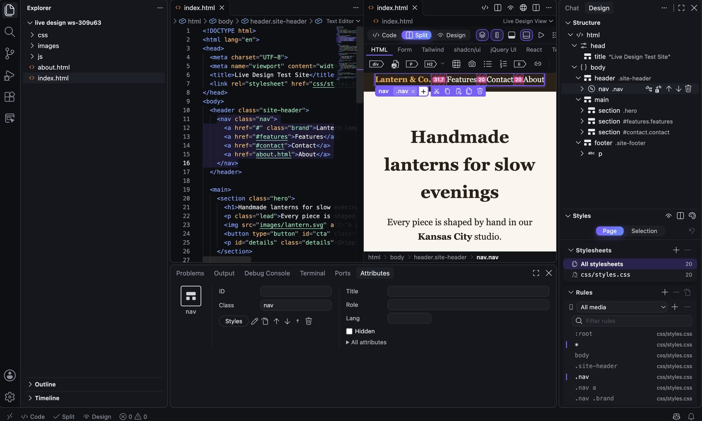
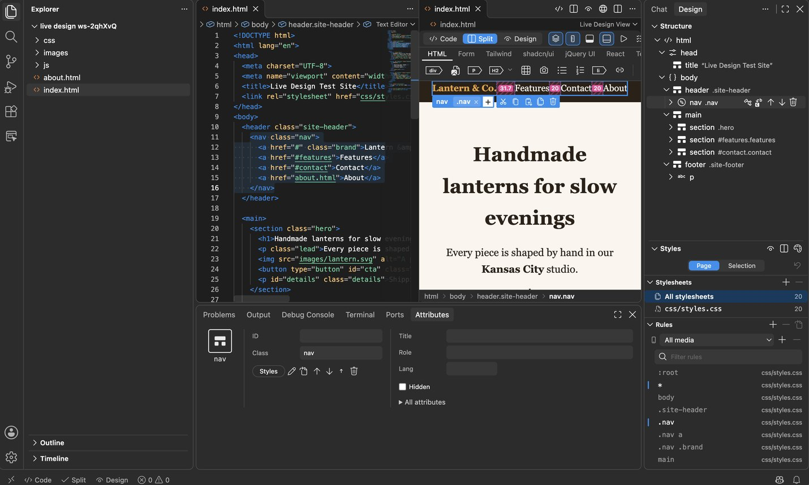
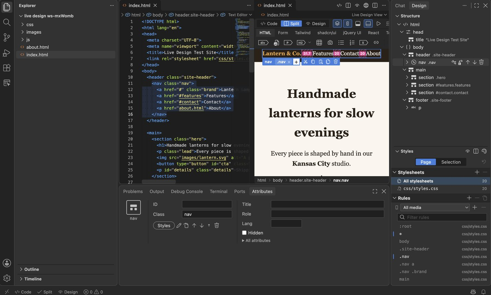
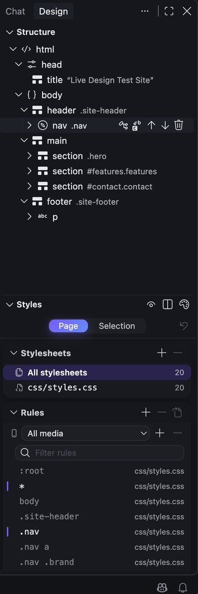
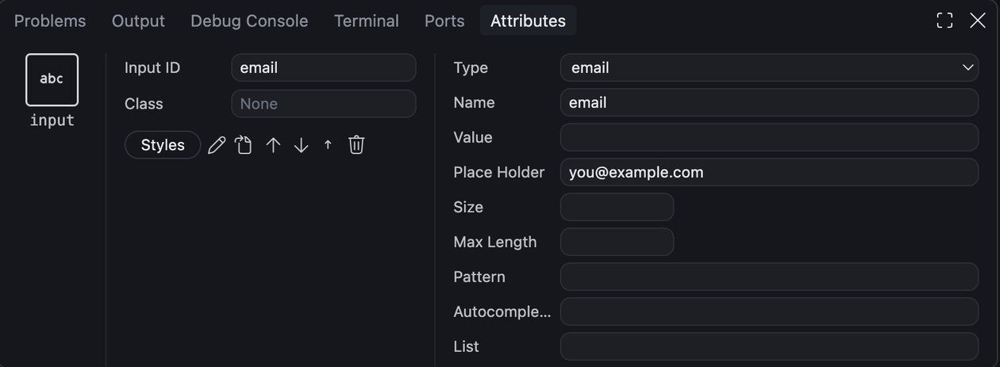
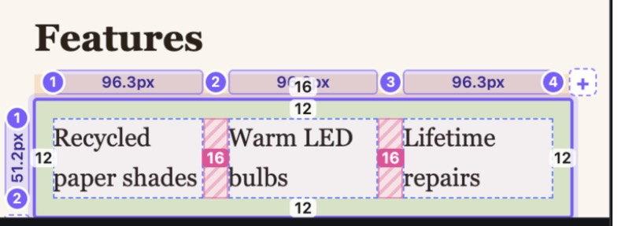

# Live Design View

A **Code / Split / Design** workflow for plain HTML files in VS Code. Select elements on a live rendering of your page, insert tags, wrap and nest them, edit text inline, and adjust attributes. Every change is written back into the real `.html` file as a small text edit, so undo/redo, the dirty marker, save and git all behave normally.



## Layout and themes

**Workspace layout.** It's set up the first time a Design view opens; the layout button in the Design toolbar, or **Live Design: Apply Workspace Layout**, re-applies it.

| Where | What |
|---|---|
| **Top** | **Elements bar** (category tabs + element icons) across the top of the Design view |
| **Left** | your **files** (Explorer). Elements and Snippets are under the Live Design activity-bar icon |
| **Right** (secondary sidebar, "Design" tab) | **Structure** (the element tree) with the **Styles** panel below it. With no page open, the Styles panel shows **Open Design View / Open Split View** at the top; its title bar has Design, Split and theme icons |
| **Bottom** | **Attributes** (the selected element's HTML attributes) |

**UI themes.** Use **Live Design: Choose UI Theme…** (🎨 in the Design toolbar), or set `liveDesign.uiTheme`:

| Theme | Look |
|---|---|
| **Modern** (default) | Custom: deep slate, violet accent, rounded card sections, soft depth |
| **Canvas** | Dark design-tool look: flat #2C2C2C panels, bright blue, compact Inter type |
| **Graphite** | Gray #323232 panels, boxed headers, blue accent, pill buttons |
| **VS Code** | Follows your current VS Code color theme |

The UI theme restyles the Design view, Elements bar, Styles panel, Elements panel and Attributes. The extension also ships matching VS Code color themes (**Live Design Modern / Canvas / Graphite**), which the command offers to switch to, so the native parts (sidebars, tabs, Structure tree, editor) match.

| Canvas | Graphite |
|---|---|
|  |  |

Built for static sites: HTML, CSS, vanilla JS and jQuery. Tailwind, shadcn/ui-style markup and React (via CDN) are available as insertable snippets.

---

## Install

**From the .vsix**

```bash
code --install-extension live-design-view-0.1.0.vsix
```

Or in VS Code: Extensions view → `…` menu → **Install from VSIX…**

**From source (Extension Development Host)**

```bash
npm install
```

Open the folder in VS Code and press **F5**. A second VS Code window opens with the extension loaded and the sample `test-site/` folder open. Open `index.html` and click the **Live** (eye) or **Split** button in the editor title bar.

---

## The three modes

| Mode | What you see | How to get there |
|---|---|---|
| **Code** | The normal text editor only | Status bar **Code**, title-bar `</>` button, `Live Design: Code View`, or **Code** in the Design toolbar |
| **Split** | Text editor on the left, Design view beside it, both on the same document | Title-bar split button, `Live Design: Split View`, or **Split** |
| **Live** | Only the Design view | Title-bar eye button, `Live Design: Design View`, or **Live** |

- Whenever an HTML file is active, the status bar (bottom left) shows **Code | Split | Design**; the current mode has a ✓. It stays there in Code mode, so you can always switch back.
- The normal text editor stays the default for `.html` (the custom editor is registered with priority `option`). You can also use **Reopen Editor With… → Live Design View**.
- The last mode you used is remembered per file (workspace state). When you reopen a file whose last mode was Split or Design, that mode is restored. Turn this off with `liveDesign.restoreLastMode`.
- Switching modes swaps editors in place. Unsaved changes are kept and VS Code never asks you to save.

### Empty pages and `<body>`

- Clicking blank space (below short content, or on an empty page) selects `<body>`, so you can **Nest** elements into it.
- An **empty file** shows an *Add HTML5 page structure* button. Its first insert writes the standard page (doctype, `<head>` with charset, viewport and title, and `<body>`) with your element inside.

### What the Design view renders

- The **current document text**, including unsaved edits, re-rendered about 300 ms after you stop typing (`liveDesign.renderDelay`). Scroll position and selection are kept across re-renders.
- Linked CSS, images, scripts and jQuery load from your workspace. Relative and root-relative `src`/`href` values are rewritten to webview URLs, and a `<base>` covers `url()` in inline styles.
- Your page's own scripts run. Clicks are intercepted for selection; toggle **Interact** (▶ in the Design toolbar) to click links and buttons normally.
- Every element gets a `data-ld-id` attribute **in the rendered copy only**, which maps it back to its exact source range (via parse5 source locations). These ids are never written into your file.
- If the HTML has structural problems (unclosed elements, stray end tags), the page still renders and a dismissible warning bar shows the first issue and its line.

---

## Elements bar (top of the Design view)

An **Elements bar** runs across the top of the Design view: category tabs over a row of element icons. Hover an icon for its name.

| Tab | Items |
|---|---|
| **HTML** | Div, Image, Paragraph, Heading (H1–H6), Table, Figure, Unordered/Ordered List, List Item, Hyperlink · Header, Navigation, Main, Aside, Article, Section, Footer · Meta, Keywords, Description, Viewport, Base, Link, Script, Email Link · Video, Audio, Canvas, Picture, IFrame · Horizontal Rule, Date, Non-Breaking Space, Line Break, Comment |
| **Form** | Form, Text, Email, Password, Url, Tel, Search, Number, Range, Color · Month, Week, Date, Time, Date Time Local · Text Area, Button, Submit, Reset, File, Image Button, Hidden · Select, Datalist, Radio Button, Radio Group, Checkbox, Checkbox Group, Fieldset, Label |
| **Tailwind** · **shadcn/ui** · **React** | See below |
| **Text** | Headings, Paragraph, Span, Strong, Emphasis, Hyperlink, Blockquote, HR, Line Break, lists |
| **Characters** | © ® ™ € £ ¥ — – … “ ” · × and Non-Breaking Space |

- **Head items** (Meta, Keywords, Description, Viewport, Base, Link) go straight into `<head>`.
- **Characters, Date and Line Break** go at the end of the selected element's text.
- With **nothing selected**, an item is added at the end of `<main>` (or `<body>`).

- **Click** an icon to place it at the selection with Before / After / Wrap / Inside.
- **Drag** an icon onto the page.
- The heading icon has an **H1–H6** picker next to it.
- Hide or show the bar with the layout button in the Design toolbar. `liveDesign.insertBar` sets the default.

## Styles panel



Style rules visually. The panel sits on the right, under **Structure**; drag it into the bottom panel for a two-column layout (Stylesheets and Rules on the left, Style on the right). In two columns the left side stays in place while you scroll the Style column.

- **Page / Selection.**
  - **Page** lists every rule from every stylesheet the page uses.
  - **Selection** lists only the rules that apply to the selected element, most specific first, plus a **Computed** entry with the values the browser actually uses (hover it for a definition).
  - In Selection mode, properties that a more specific rule overrides are ~~struck through~~. Rules that only apply in a state (`:hover`, `::before`) are dimmed.
- **Stylesheets.** The page's linked local `.css` files and its `<style>` blocks. **+** offers a **new CSS file**, **linking an existing file**, or a **`<style>` in this page**. **−** unlinks it (the file itself is kept).
- **Rules.** A media filter at the top (**All media**, **Base styles**, or one `@media`; **+** adds a breakpoint, **−** removes one and keeps its rules), a filter box, **+** to add a rule, **−** to delete it, and **Go to code**.
  - In **Page** mode, clicking a rule also selects the first element it matches on the page (or keeps the current one if it already matches). Click it again to step to the next match.
  - With an element selected, rules that apply to it have an accent bar; the others fade back.
  - **Drag a rule** (grip on hover) above or below another to **reorder** it in the stylesheet, which changes the cascade order. **Alt+↑ / Alt+↓** move the selected rule. A comment directly above a rule moves with it, and rules moved into or out of an `@media` block are re-indented. Reordering works in Page mode within one stylesheet.
  - **+** suggests a selector for the selected element (e.g. `#features h2`). Use **↑/↓** for more or less specific suggestions, and **Enter** to add it. New rules go into the media query picked in the filter.
- **Style** of the selected rule, grouped as **Layout, Type, Background, Borders, Other**. Each group is an **accordion**: click its header to collapse or expand it (remembered), **Alt-click** to show only that group. A badge counts the properties the rule sets in the group. The icons jump to (and open) each group.
  - Controls include selects and icon buttons for keywords, color swatches with a color picker, and a **margin/padding box widget**. The widget edits the `margin` shorthand if the rule has one, otherwise `margin-top` etc.
  - Grey placeholders show the selected element's computed values.
  - **Linked sides (visual shorthand).** Under *margin* and *padding* are three toggles:
    - **Chain** links all four sides: type once and the rule gets `padding: 8px`.
    - **↔** links left and right; **↕** links top and bottom. Use both for `padding: 8px 16px`, or ↔ alone for `padding: 8px 16px 4px`.
    - Turning a link on copies one value across (top for ↕, left for ↔). While any link is on, the box writes the shortest `margin`/`padding` shorthand and removes the longhands it replaces. Linked cells are outlined.
    - The toggles start from what the rule already has: one value turns on the chain, two values turn on both pairs.
  - **Units.** Length fields (width/height, min/max, top/right/bottom/left, margin, padding, font size, gaps, radius…) have a unit dropdown. Typing a bare number adds the selected unit (**px** by default), so `20` writes `20px`. The dropdown switches between px, %, em, rem, vw, vh, ch and pt, and offers `auto`, `normal` or `none` where the property allows them. Values you type with their own unit, or `calc()` / `var()`, are kept as typed. Unitless properties (z-index, opacity, font-weight) keep plain numbers; line-height can be either. **↑/↓** nudge by 1 (Shift 10, Alt 0.1).
  - **Set only** shows only the properties the rule sets.
  - Hover a set property to **disable** it (comments it out) or **delete** it.
  - **More** lists other set properties and lets you add any property by name.
- **Saving and undo.**
  - Every change is a minimal edit to the stylesheet text; nothing is re-serialized.
  - Linked `.css` files are saved right after the change (`liveDesign.css.autoSave`). With auto-save off, the Design view still shows unsaved CSS because it renders the editor's text.
  - The **↶** button (or **Cmd/Ctrl+Z** in the panel) undoes Styles panel changes. Changes to `<style>` blocks also undo with normal page undo.

### Auto layout 

At the top of the **Style** column, an **Auto layout** block writes real CSS to the **selected rule**:

| Control | CSS it writes |
|---|---|
| Header toggle | add `display: flex`, or remove auto layout |
| **Flow:** Freeform · Vertical · Horizontal · Grid, plus **Wrap** beside it | removes `display` · `flex-direction: column` · `flex-direction: row` · `display: grid; grid-template-columns: repeat(2, 1fr)` · `flex-wrap: wrap` |
| **W / H** with ▾ Fixed · Hug contents · Fill container · Auto; resize-to-fit icon | depends on the **parent** — see *Sizing* below |
| **Alignment** 3×3 picker | `justify-content` + `align-items` (axes swap for Vertical). In Grid: `justify-items` + `align-items`. **Double-click** a cell to toggle *space between* (Auto gap) and back; the fixed gap is restored |
| **Gap** with ▾ Fixed / Auto | `gap`; Auto = `justify-content: space-between` |
| Advanced (sliders icon) | cross-axis gap, `align-content`, stretch children; for Grid: Columns / Rows counts and column / row gaps |
| **Padding**: horizontal / vertical, or individual sides | `padding-*` |
| **Clip content** | `overflow: hidden` |

- Number fields take ↑ / ↓ to nudge by 1 (Shift: 10). Bare numbers get `px`.
- Each change is one edit to the rule, so one undo step reverts it.
- Every control has a tooltip with its name and the CSS it writes.

### Sizing: Fixed · Hug · Fill · Auto

What Fill and Hug mean depends on the element's **parent layout** and **which axis** you size. The CSS written:

| Parent | Fill container | Hug contents | Fixed |
|---|---|---|---|
| flex, **main** axis (W in a row, H in a column) | `flex: 1 1 0%; min-width: 0` | `flex: 0 0 auto` | `width: Npx; flex: 0 0 auto` (keeps its size) |
| flex, **cross** axis | `align-self: stretch` | `height: fit-content` (beats the default stretch) | `height: Npx` |
| grid | `justify-self` / `align-self: stretch` | `fit-content` | px |
| block flow | width: `auto` (block) / `100%` (inline-level); height `100%` | width `fit-content`; height auto | px |

- **Auto** removes everything the other modes set.
- Switching modes clears the previous mode's leftovers (e.g. Fill's `min-width`).
- The field shows the current mode read back from the rule, and hovering the ▾ shows exactly what each mode writes in that context.

### Flex / Grid controls

When a rule's `display` is **flex** or **grid** (from Quick Layout or the `display` menu), the Layout group shows a matching block right under `display`:
- **Flex Container:** direction arrows, wrap, `justify-content` and `align-items` as icon buttons that draw the alignment, `align-content` when wrapping, and gap / row-gap / column-gap.
- **Grid Container:** columns and rows (with presets such as `repeat(3, 1fr)` and `repeat(auto-fit, minmax(200px, 1fr))`), areas, auto-flow, gaps, and `justify/align-items/content`.
- **Flex Item / Grid Item:** appears when the selected element's **parent** is flex or grid: grow, shrink, basis, align-self, order; or grid-column, grid-row, area, justify-self.

## Panels (activity bar → Live Design)

The panels are native VS Code views. Drag them to the secondary sidebar or the bottom panel like any other view.

### Elements

A list of elements with a category picker: **HTML, Form, Text, Media, Tailwind, shadcn/ui, React**. When the panel is wide and short (for example docked in the bottom panel), it switches to a classic **tab strip with an icon bar**.

- **Click** an item: a popover appears on the selected element in Design view.

  | Button | Key | Result |
  |---|---|---|
  | **Before** | `B` | New element on its own line before the selection |
  | **After** | `A` | New element on its own line after the selection |
  | **Wrap** | `W` | Selection is wrapped in the new tag (its lines are indented one level) |
  | **Nest** | `N` | New element as the **last child** (`Shift+N` or `F` for **first child**) |

  `←`/`→` move between buttons, `Esc` closes. If nothing is selected, the element is added at the end of `<main>` (or `<body>`).
- **Drag** an item onto the page. A blue **line** marks Before/After (top or bottom quarter of the target). A blue **box** marks Inside (middle of a container). Elements that can't contain children (`img`, `input`, `br`, …) only offer Before/After.
- Invalid targets are refused with a short message in the Design toolbar, for example "`` can't contain other elements."
- New code is indented to match the surrounding lines (tabs or spaces, detected from the file). Nothing else in the file is reformatted. The new element is selected in Design view and, in Split, in the code editor.
- **jQuery UI**: Accordion, Tabs, Dialog, Datepicker, Autocomplete, Slider, Progressbar, Button, Buttonset, Checkbox Buttons, Radio Buttons. Each inserts its markup plus an init script, with numbered ids (`Accordion1`, `Accordion2`…). jQuery UI (and its theme CSS) is added once: right after the page's own jQuery if it has one, otherwise with jQuery in `<head>`. The widgets run in the Design view; use Interact mode to click tabs and accordion headers.
- **shadcn/ui** has every component from ui.shadcn.com/docs/components (66), grouped as **Actions, Forms, Layout, Navigation, Overlays, Feedback, Data, Chat & AI** (sub-tabs in the Elements bar, headings in the Elements panel), with text labels. They are static HTML + Tailwind in shadcn's default zinc style; overlays (Dialog, Sheet, Dropdown, Popover…) are shown open so you can design them.
- **Tailwind** and **shadcn/ui** items add the Tailwind CDN `<script>` to `<head>` once. **React** items add React 18 + ReactDOM + Babel standalone (CDN) and a `<script type="text/babel">` component. The head scripts and the element are added in a single undo step.

### Structure

A tree of the document's elements; scripts and styles are hidden. Selecting a node selects it in Design view and in the code editor, and the tree follows selections made elsewhere.

- **Class / ID** (row button, double-click or F2): type the element's names, e.g. `.card .featured #promo`. Clear the text to remove them.
- **Change Tag** (row button or ⇧F2): pick a new tag (`div` → `section`, `p` → `h2` …) or type any tag name. Attributes and content are kept.
- **Drag** a node to move the element. VS Code trees only report the item you drop on, so:
  - onto a **container** (div, section, header, main, nav, ul, li, form, …): it's **nested** inside as the first child;
  - onto anything else (headings, paragraphs, images, links…): it takes that element's place (before it when dragging up, after it when dragging down);
  - onto empty space: the end of `<body>`.

  To reorder two containers, use Move Up / Move Down or drag on the page.
- **Copy / Cut / Paste / Paste As Child / Duplicate** in the context menu, or ⌘C / ⌘X / ⌘V / ⇧⌘V / ⌘D while the Structure panel has focus. F2 edits class/ID. Copied HTML also goes to the system clipboard, so you can paste it into code.
- Inline buttons: **Move Up / Move Down / Delete**. The context menu adds **Edit Text**, **Reveal in Code** and **Save as Snippet**.

### Snippets

Your own snippet library, organized in **pattern folders**. It starts with `HTML_Snippets`, `Tailwind_Layouts`, `shadcn_Patterns` and `React_Components`.

- **Save Selection as Snippet** (💾 in the panel title, the Structure context menu, or the code editor's context menu) saves the selected Live element or the selected code. It asks for a folder (or creates a new one), a name and an optional **trigger key**.
- **Click** a snippet to place it with Before / After / Wrap / Inside, like an Elements item.
- **Trigger keys:** type one in an HTML file (for example `sclogin`) and pick it from IntelliSense to expand the snippet.
- Snippets are plain files: `<library>/<Folder>/<Name>.html`, with an optional first-line header:

  ```html
  <!-- snippet: {"trigger": "cta", "description": "Call to action", "requires": ["tailwind"]} -->
  <a class="rounded-md bg-indigo-600 px-4 py-2 text-white" href="#">Get started</a>
  ```

  Snippets that use Tailwind classes or `text/babel` scripts are detected automatically, so their CDN scripts get added too. Set `liveDesign.snippetsFolder` to keep the library in a synced or shared folder. **Open Snippets Folder** reveals it.

### Attributes (bottom panel) — HTML only



An **Attributes** panel for the element's **HTML** (tag and attributes). Styling lives in the **Styles panel**; use its button here to jump to it. The panel opens automatically the first time a Design view opens (`liveDesign.showPropertiesOnOpen`), and the 🗔 button in the Design toolbar reopens it. It's a **Properties** tab next to Terminal; drag it elsewhere if you like.

- **Left:** the element type, its **ID**, and **Class**. Class lists the class names from your stylesheets; picking one adds it, or type several.
- **Buttons:** **Styles panel**, Edit Text, Go to Code, Move, Select Parent and Delete.
- **Right:** fields for the element type:

| Element | Fields |
|---|---|
| **Div** / other | Title, Role, Hidden |
| **Paragraph / Headings / Pre** | **Format** (Paragraph, Heading 1–6, Preformatted, None) renames the tag |
| **Image** | Src (📁 browse), Alt, W, H, Title, **Link** (wraps the image in `<a href>` or edits its link), **Target**, Loading |
| **Link** `<a>` | Link (📁), Target, Title, Rel, Download |
| **Form** | Name, Action (📁), Method, Enctype, Target, Autocomplete, No Validate |
| **Input** (per type) | Type, Name, Value. Text types add Place Holder, Size, Max Length, Pattern, Autocomplete, List. Number/range/date types add Min, Max, Step. File adds Accept. Plus Title, Tab Index, Form, and Required / Disabled / Read Only / Auto Focus (+ Checked, Multiple where they apply) |
| **Text Area** | Name, Rows, Cols, Place Holder, Max Length, Wrap, Required / Disabled / Read Only / Auto Focus |
| **Select** | Name, Size, **List Values** (edit item labels, values and which is selected), Multiple / Required / Disabled |
| **Button** | Type, Name, Value, Form Action, Disabled / Auto Focus |
| **Label** | For (picks from the page's form control ids), Format |
| **Table / cells** | W, Border, CellPad, CellSpace, Summary · Col Span, Row Span, Scope |
| **IFrame / Video / Audio** | Src, Poster, W, H, Preload, Loading, Controls / Autoplay / Loop / Muted |
| **Meta / Link / Script / Base** | Name, Content, Charset · Rel, Href, Media · Src, Type, Defer / Async · Href, Target |

**All attributes** at the bottom lists every other attribute and lets you add one. Each change is a minimal edit to the element's start tag. Boolean attributes are written bare (`required`).

---

## Links and pages

- **Follow links** in Interact mode (▶), or **⌘/Ctrl-click** a link in design mode:
  - `#anchor` scrolls the Design view to it;
  - another page of the site (`about.html`, `index.html#features`) opens in Design view, scrolled to the anchor;
  - a page that doesn't exist yet offers **Create Page** (a new HTML5 page);
  - external links (`https:`, `mailto:`, `tel:`) open outside VS Code.
- **Check Links** (link checker): broken local links (`href`/`src` to missing files) and missing `#anchors` (on this page or another) show in the **Problems** panel as you edit. **Live Design: Check Links Sitewide** checks every HTML file in the workspace. Turn off with `liveDesign.checkLinks`.

## Audit: accessibility (ADA / WCAG), SEO, best practices, forms

The **checklist** button in the Design toolbar (or **Live Design: Audit Page**) runs a Lighthouse-style audit of the page as it is now (unsaved edits included):

- **Accessibility** uses **axe-core**, the engine behind Lighthouse's accessibility audits, run inside the Design view against WCAG 2.0/2.1/2.2 A and AA plus best-practice rules (contrast, alt text, labels, landmarks, headings, ARIA…).
- **SEO:** title, meta description, viewport, `lang`, one `<h1>`, descriptive link text.
- **Best Practices:** doctype, charset, `rel="noopener"`, insecure `http://` resources, obsolete tags, image width/height (layout shift), duplicate ids.
- **Forms:** every field has a label (placeholders don't count), fields have a `name` (or they aren't sent), a submit button, an action, no password over GET, the right `type` (email/tel/url) and `autocomplete` tokens (WCAG 1.3.5), explicit button types.

Results appear as **0–100 scores** (weighted by impact, like Lighthouse) in a bar above the page, **numbered markers** on the elements (click to select), and in the **Problems** panel on the exact start tag, with a link to the rule's documentation.

The pulse button (or **Live Design: Run Lighthouse Report**) runs the real **Lighthouse** in a terminal on the saved file and opens its HTML report (needs Node and Google Chrome).

**Testing forms:** in Interact mode, submitting a form runs the browser's own validation (required, `type="email"`, `pattern`, min/max…). An invalid field is reported on the canvas. A valid submit is caught (the page doesn't navigate away) and shows what would be sent: method, action and each `name = value`, also logged in the **Live Design: Form Tests** output.

## Editing on the canvas

- **Copy / Cut / Paste / Duplicate / Delete:** with an element selected in Design view, use ⌘C / ⌘X / ⌘V (paste after it) / ⇧⌘V (paste inside it) / ⌘D / ⌫. Ctrl on Windows/Linux. The same actions are buttons next to the selection's tag chip (scissors, copy, paste, duplicate, trash); Shift-click paste to paste inside.
- **selection chip** (the blue chip on the selection):
  - shows the tag, then one pill per `#id` / `.class`;
  - **click a pill** to change it, **×** removes it, **+** adds one;
  - while typing, a hints list shows the classes and IDs defined in your stylesheets (and classes used elsewhere on the page). ↑/↓ pick, Tab completes, Enter applies, Esc cancels. Type several at once (`.card .featured #promo`). A new `#id` replaces the old one.
- **New names get a CSS rule:** when you add a class or ID that no stylesheet defines yet, a small prompt offers to create the empty rule (`.name {}`) in the stylesheet you pick (or a new `<style>` block). The new rule is selected in the Styles panel. Tick **Always create** to skip the prompt next time.
- **Change the tag:** double-click the selection's tag chip (e.g. `div` → `section`). Attributes and content are kept.
- **Box model** (layers button, on by default). For the selected element, the page shows:
  - **margin** (orange), **border** (yellow) and **padding** (green), each labelled in px;
  - for **flex** containers, the **gaps / free space between items** (hatched pink, labelled) and dashed outlines on the items;
  - for **grid** containers, the **grid inspector**.

  **Edit on the canvas with handles:**
  - **Click** a gap, padding or margin area to type a value (bare numbers get px; ↑/↓ nudge).
  - **Drag** it to change the value live. Shift snaps to 10; Alt changes both opposite sides (padding / margin).
  - Dragging the free space in a *space-between* flex sets a fixed gap and leaves Auto mode.

  **Grid inspector** (built on Chrome/Firefox DevTools' grid overlay and 's grid editor):
  - Slim **column / row headers** show each track's computed size.
  - **Line numbers** (1, 2, 3…) sit on the track boundaries.
  - **Click a header** to set that track's size (`1fr`, `240px`, `auto`, `minmax(…)`).
  - Hover a header and click **×** to remove that track; **+** at the end of each header bar adds one.
  - Column and row gaps are editable handles.
  - Track lists are expanded from `repeat(n, …)` for editing and written back compactly (`repeat(3, 1fr)` when all tracks match). `auto-fill` / `auto-fit` templates are left for the Styles panel.

  **Where edits go:**
  - the rule selected in the Styles panel, if it applies to the element;
  - otherwise the element's own rule (one that targets its class or id);
  - otherwise its inline `style`.

  The status bar of the Design view says which rule it went to. Everything is one undo step.

  
- **Outlines** (ruler button): empty elements get a dashed outline and a minimum height, so you can see them and drop into them. This only affects the Design view, never your file.
- **Drag to move:** press on the selected element (or its blue chip) and drag. The blue line or box shows where it will land (before / after / inside), as with Insert drags. It can't be dropped into itself, and `Esc` cancels.

- **Hover:** dashed outline plus a tag label (`div.card`).
- **Click:** selects the element (blue outline). In Split, its full source range is selected and revealed in the code editor. Moving the cursor in the code editor highlights the innermost matching element in Design view.
- **Element chip** (`section.hero` **+**): click **+** and type `.name` to add a class or `#name` to set the id.
- **Double-click** (or `Enter`) on a text element edits its text inline. `Enter` or clicking away commits; `Esc` cancels. Only the changed text ranges are rewritten, so entities and inline tags elsewhere are untouched.
- **Breadcrumbs** at the bottom (`html › body › main › section.hero › h1`): click a crumb to select that ancestor.

### Keyboard shortcuts (Design view)

| Key | Action |
|---|---|
| `Delete` / `Backspace` | Delete the selected element (the whole line when it's alone on its line) |
| `Alt+↑` / `Alt+↓` | Move the element before / after its sibling |
| `↑` | Select the parent element |
| `Enter` | Edit the element's text inline |
| `Esc` | Clear the selection / close the popover / cancel text editing |
| `B` `A` `W` `N` (`Shift+N`, `F`) | Choose a placement while the insert popover is open |
| `Cmd/Ctrl+Z`, `Cmd/Ctrl+S`, … | Normal VS Code undo, save, etc. |

---

## How it works

- **parse5** with `sourceCodeLocationInfo: true` re-parses the document after every change, so offsets are always current. Each element's start tag, end tag, attribute and text-node ranges come from those source locations.
- All changes go through `WorkspaceEdit` on the `TextDocument`. Nothing is written to disk directly and the DOM is never re-serialized.
- The page renders in a same-origin iframe inside the webview. That frame is VS Code's own service-worker-served page with the document written into it, which is what lets workspace CSS, images and scripts load.

## Development

The integration tests click every Design toolbar button (box model, outlines, Elements bar, interact, Attributes, Workspace layout, theme) and check the result, so `npm test` covers the toolbar as well as editing.


```bash
npm run compile            # type-check + bundle with esbuild
npm run watch              # rebuild on change (used by F5)
npm run test:unit          # pure edit/model tests (node:test)
npm run test:integration   # runs the extension inside VS Code against a copy of test-site/
npm run package            # production bundle
npx vsce package           # build the .vsix
```

The integration suite drives the real webview: asset loading, mode switching without losing unsaved changes, Split sync, Structure-panel sync, popover inserts, Wrap, drops, inline text edits, Properties edits, delete/move, undo, scroll preservation, broken HTML, Tailwind styling applied in Design view, a React component rendering, and snippet insertion with trigger-key completion.

## Known limits

- **Plain static HTML only.** Server templates (PHP, Handlebars, …) aren't evaluated, and framework components aren't editable as components.
- **React:** you can select the mount element (for example `#root`), but elements React renders inside it don't exist in the source, so they can't be selected or edited from Live. Edit the component code instead.
- **shadcn/ui** items are static HTML + Tailwind markup styled like shadcn's defaults, not the React components. The CDN-based Tailwind, React and Babel need network access.
- Elements created by your own scripts (jQuery appends, etc.) can't be mapped to source. Clicking them selects their nearest source ancestor. Inline text editing refuses elements whose text a script has changed.
- Inline text editing is plain text. Adding tags inside text (bold, links) is done with the Elements bar (Inside/Wrap) or in code.
- Inline `on…="…"` event handlers in your HTML may be blocked in the Design view.
- Dragging from the **sidebar** Elements panel onto the page uses native drag-and-drop between two webviews, which isn't covered by the automated tests. Dragging from the Insert **bar** at the top of the Design view stays inside one page. Click-to-place always works, and Snippets panel items are click-to-place only.
- **Styles panel:**
  - Edits local stylesheets and `<style>` blocks, not remote (CDN) CSS or inline `style=""` attributes.
  - Sass/Less and other preprocessors aren't supported.
  - `@import`-ed files aren't listed as separate sources.
  - The cascade view approximates specificity and order. It doesn't model `!important` across origins, `@layer` or `@container`.
- `<template>` contents, SVG and MathML internals can be selected but not inserted into.
- Implied elements the parser adds (`<tbody>`, or `<html>`/`<body>` when omitted) appear in the Structure panel and breadcrumbs but can't be edited.

## License

MIT. See [LICENSE](LICENSE). Bundled and referenced open-source software is listed in [THIRD-PARTY-NOTICES.md](THIRD-PARTY-NOTICES.md).

Live Design View is an independent project, not affiliated with or endorsed by the owners of the libraries and tools it works with. Product names are used only to describe compatibility.
